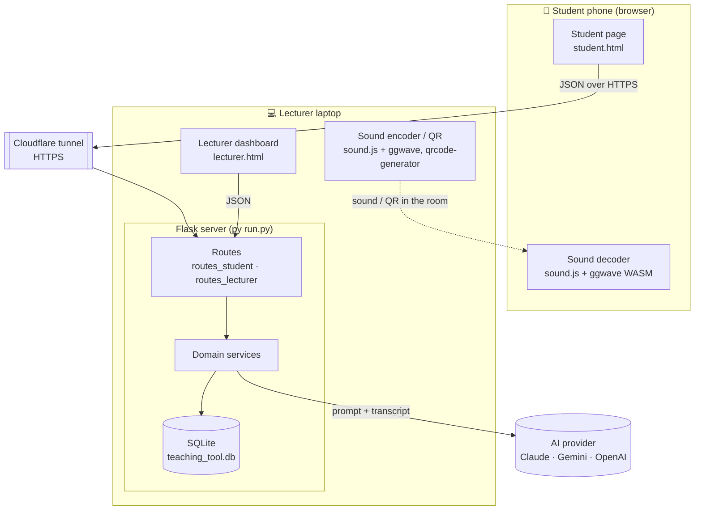
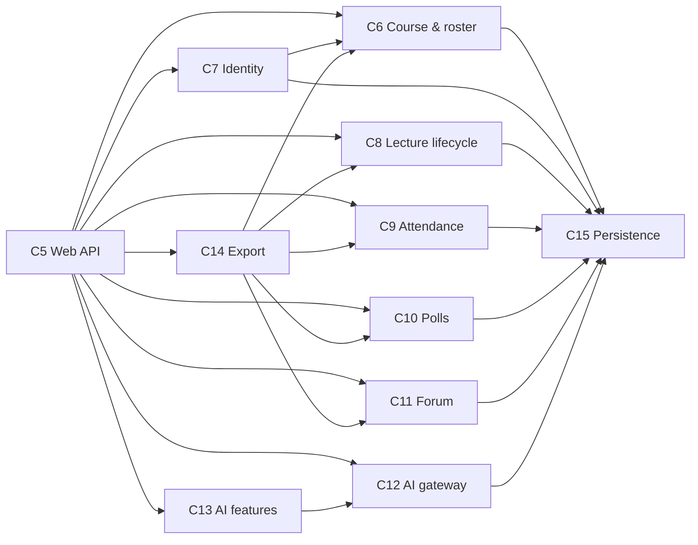
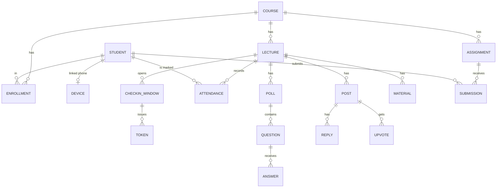

# Main Software Components

Assignment To-Do #7: *"Define the main software components."*
The low-level classes inside each component are in [DIAGRAMS.md](DIAGRAMS.md).

## 1. Architecture at a glance
A **client–server** web app. Phones and the lecturer's browser are thin clients. **Every decision is made on the server.** For example, a phone only reports the code it heard, and the server decides whether that counts.

**Why this shape:**
- **HTTPS through a tunnel:** browsers only allow the microphone on HTTPS.
- **Sound is decoded on the phone:** no audio ever leaves it (NFR-4).
- **One laptop runs everything:** simple to demo (SRS §2.2). A cloud server is future work.

## 2. Components
| # | Component | Files | Responsibility | Built or composed |
|---|---|---|---|---|
| C1 | **Student client** | `templates/student.html` | Registration, lecture list, *Get ready / Check in*, polls, forum, materials. Polls the server every 3 s | Ours |
| C2 | **Lecturer client** | `templates/lecturer.html` | Courses, lecture list and lifecycle, check-in windows, live sheet, poll builder, forum moderation, materials and AI, settings. Polls every 2.5 s | Ours |
| C3 | **Sound channel** | `static/sound.js` | `broadcast(token)` on the laptop; `listen(onToken) → stop()` on the phone; a plausibility check on decoded text | **Composed:** ggwave 0.4.0 (MIT), WebAudio |
| C4 | **QR channel** | `lecturer.html` | A full-screen rotating QR (`/j/<token>`) and a *Join QR* | **Composed:** qrcode-generator 1.4.4 |
| C5 | **Web API** | `routes_student.py`, `routes_lecturer.py`, `__init__.py` | Thin HTTP layer: parse the request, call a service, return JSON. Lecturer PIN, device cookie | **Composed:** Flask |
| C6 | **Course & roster** | `roster.py` | Courses, students, enrollments; import from CSV or xlsx (names only) | Ours (+ openpyxl) |
| C7 | **Identity** | `identity.py` | One name ↔ one phone; claim, release and reset | Ours |
| C8 | **Lecture lifecycle** | `lectures.py` | Draft → Open → Closed → Reopen, as a state machine; materials | Ours |
| C9 | **Attendance** | `attendance.py` | Check-in windows, one-time short-lived tokens, Present / Late / Absent | Ours |
| C10 | **Polls** | `polls.py` | Multi-question polls (quiz, choice, text), launch and close, answers, results, file import and template | Ours |
| C11 | **Forum** | `forum.py` | Posts (named or fully anonymous), replies, 👍, delete | Ours |
| C12 | **AI gateway** | `llm.py` | The `LLMClient` interface + Claude, Gemini, OpenAI and offline clients; the settings store, with the key kept server-side | **Composed:** anthropic, google-genai, openai SDKs |
| C13 | **AI features** | `ai_tools.py` | Teaching feedback (our prompt + measured stats) and the student summary | Ours |
| C14 | **Export** | `export.py` | Excel workbook per course | **Composed:** openpyxl |
| C15 | **Persistence** | `db.py` | SQLite schema and connection | **Composed:** SQLite |
| C16 | **Homework** | `homework.py` | Assignments (with an optional deadline), student submissions (the latest counts), peer selection (5 most recent, no names), the student review prompt | Ours |
| C17 | **File reader** | `textfiles.py` | Word (.docx, read directly from its XML), PDF, text and code → plain text | Ours (+ pypdf) |
| C18 | **App settings** | `app_settings.py` | The public phone address for QR codes | Ours |

## 3. Component dependencies

**Rules that keep the design clean:**
- **Dependencies point one way.** Routes depend on services, and services depend on persistence. No service knows about HTTP.
- **Replaceable parts sit behind interfaces** (Open/Closed principle):
  - `RosterSource`: CSV and xlsx today, Moodle later.
  - `LLMClient`: Claude, Gemini, OpenAI, Offline.
  - Check-in channel: sound or QR, both producing the same token.
- **Time is injected** (`clock=time.time`) into every service that uses it, so expiry rules can be tested with a fake clock.

## 4. Data model

A `POST.student_id` is **NULL** for anonymous posts (D-8). `SETTINGS` holds the AI provider, the model and the key.

## 5. External dependencies
| Dependency | Version | Used for | Tested in real life |
|---|---|---|---|
| ggwave (JS/WASM) | 0.4.0 | Data over sound | ✅ Real phone (see the Tools report) |
| Flask | 3.1 | Web server | ✅ |
| SQLite | built in | Storage | ✅ |
| openpyxl | 3.1 | Excel import and export | ✅ (tests) |
| qrcode-generator | 1.4.4 | QR codes | ✅ Scanned by two phones (university Wi-Fi and mobile data) |
| Cloudflare quick tunnel | cloudflared | HTTPS for phones | ✅ (with a network caveat) |
| google-genai | 3.3 | Gemini | ✅ Real lecture transcript |
| anthropic / openai | 2.8 / 3.51 | Claude / OpenAI | ⚠️ Code path only, no key available |
| pypdf | 7.0 | Reading PDF homework | ⚠️ Code path only; Word and text are unit-tested, PDF is to be tried in the demo |
| pytest | 9.0 | Tests | ✅ 54 tests |
