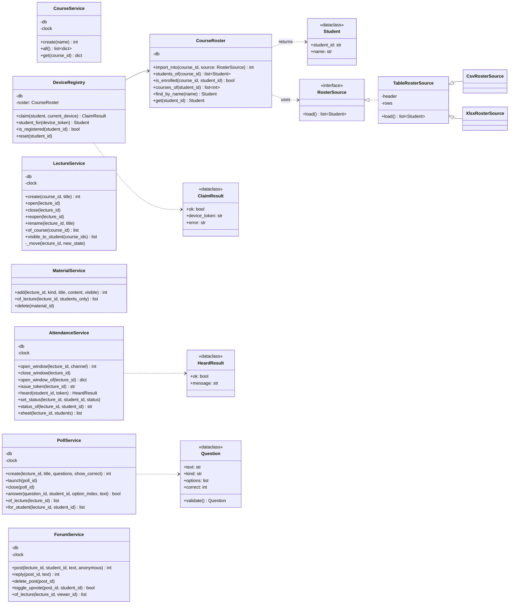
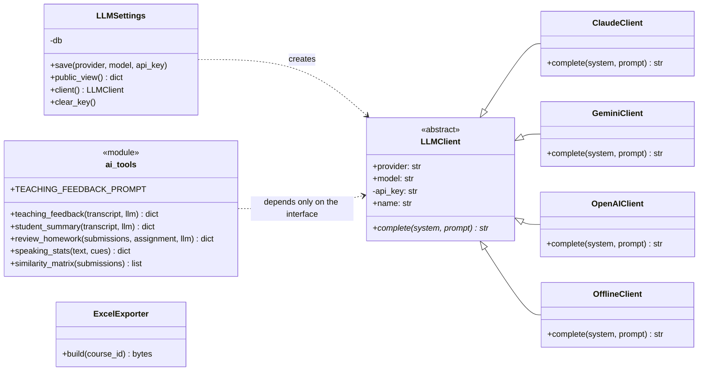
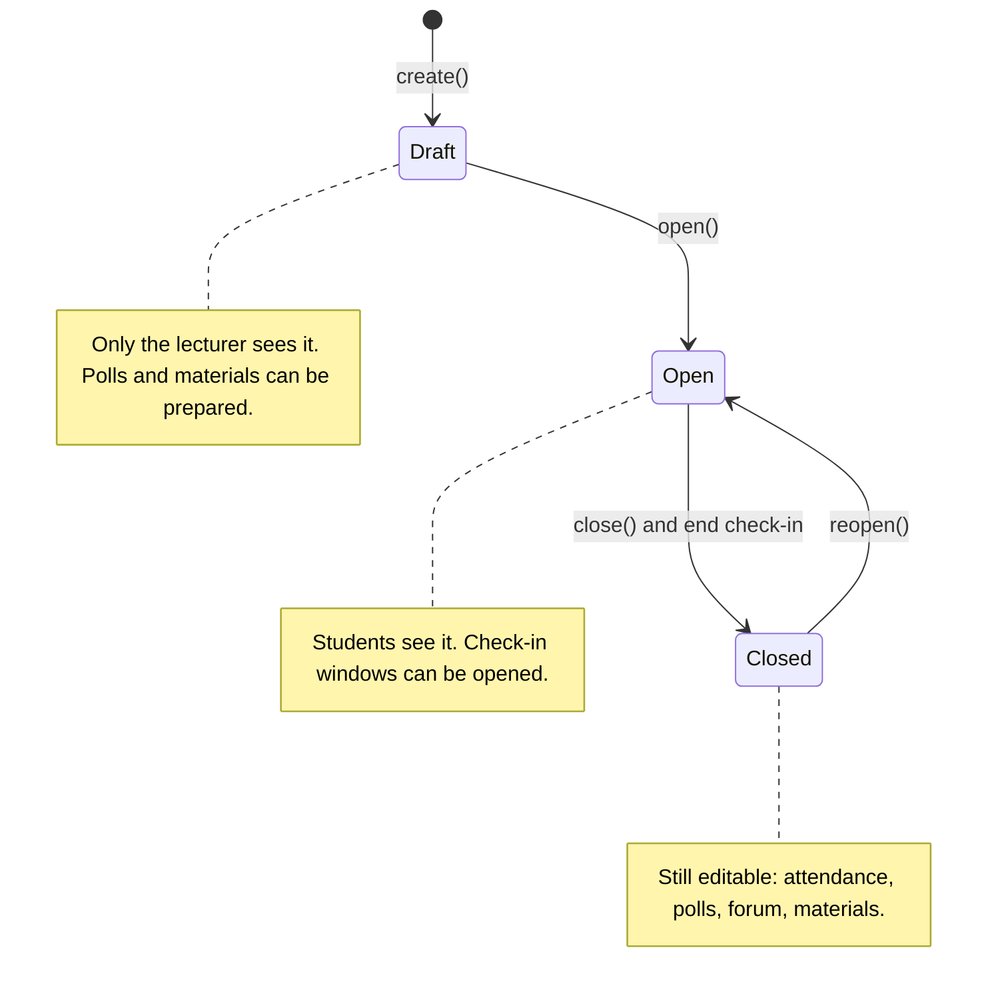
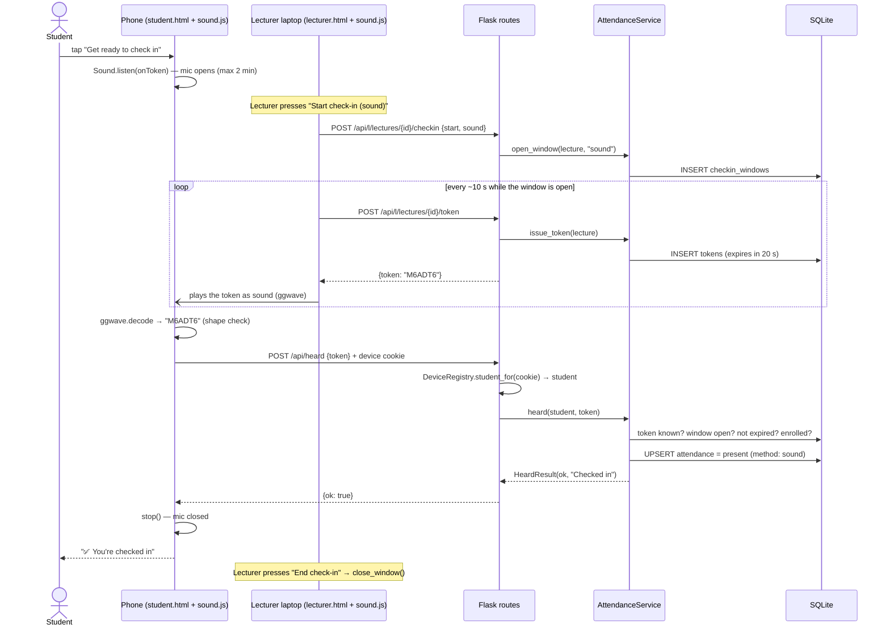
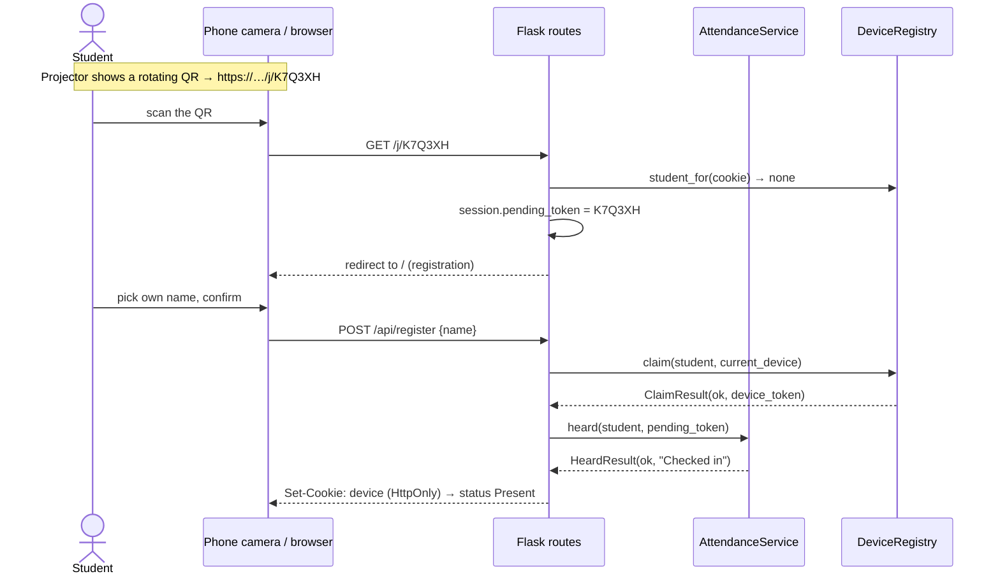
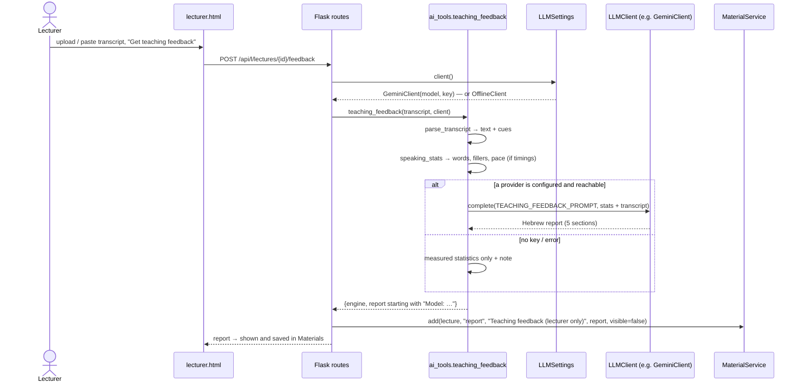
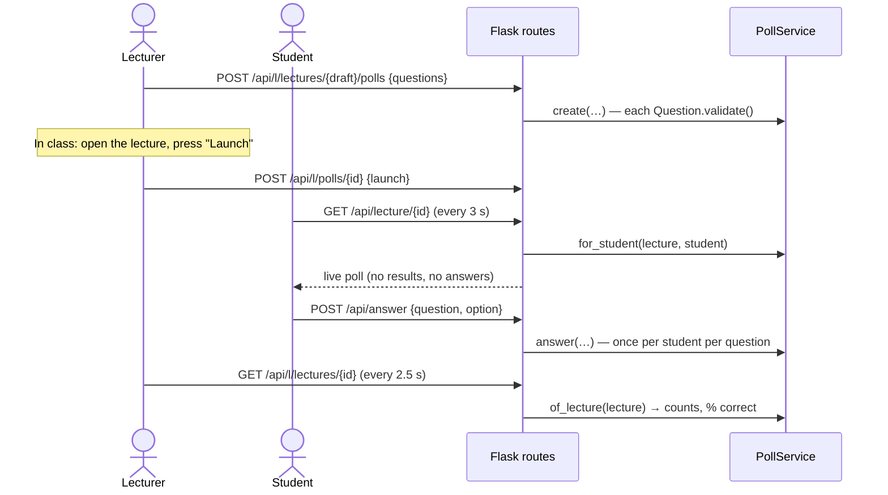

# Class and Sequence Diagrams

Assignment To-Do #8: *"Define low-level class diagrams and sequence diagrams."*
The diagrams are written in Mermaid, which GitHub renders as images. They match the code in `app/`. Method signatures are simplified, and `db` is the SQLite connection passed into every service.

---

## 1. Class diagram: domain services

## 2. Class diagram: AI gateway (Strategy pattern)

**Why Strategy:** `teaching_feedback()` only calls `llm.complete()`. Adding Gemini and OpenAI next to Claude did not change a single line of the AI features (Open/Closed). `OfflineClient` is the *Null Object*: without a key, the features take their offline path instead of crashing.

## 3. State diagram: the lecture as an object

Any other transition, for example closing a draft, raises `LectureStateError`. The allowed moves are one table in the code (`TRANSITIONS` in `lectures.py`).

---

## 4. Sequence diagram: sound check-in with "Get ready" (UC-4, main flow)

## 5. Sequence diagram: QR check-in for a student not yet registered (UC-4a + UC-3)

## 6. Sequence diagram: teaching feedback (UC-10)

## 7. Sequence diagram: poll prepared in advance (UC-6, UC-7)

