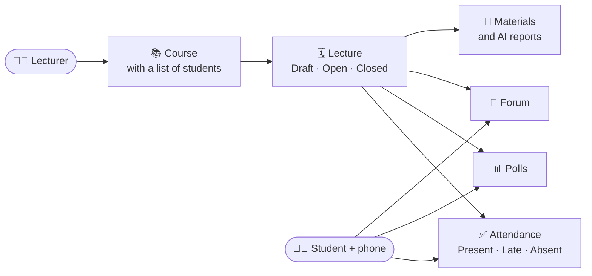
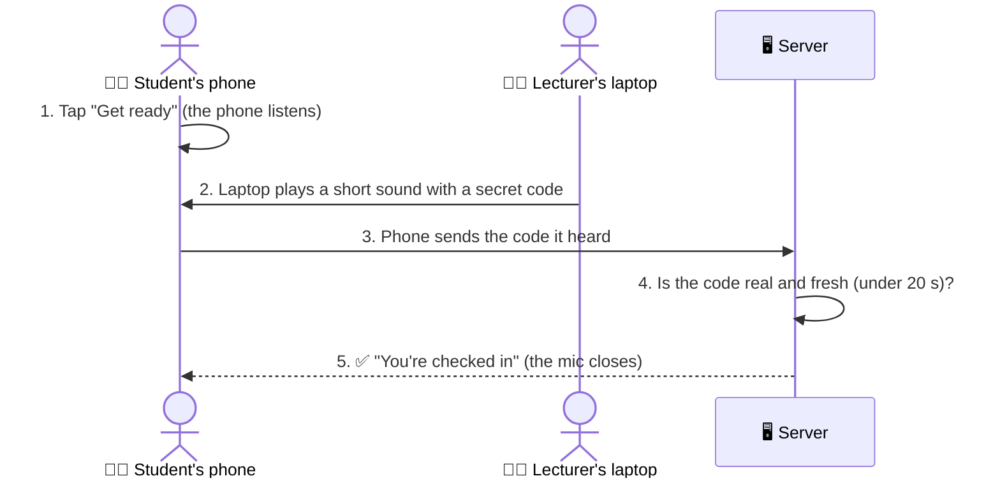
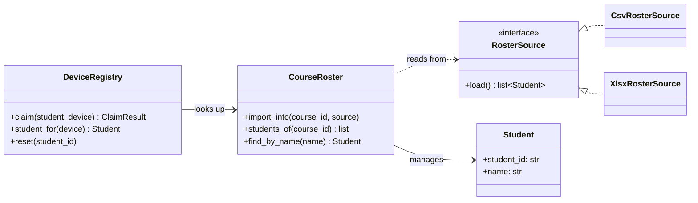
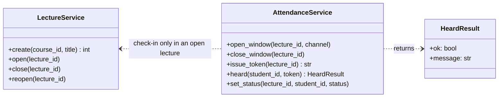
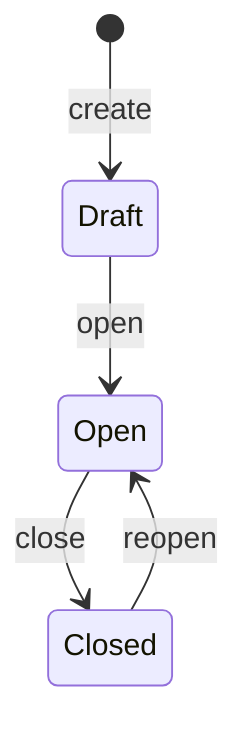
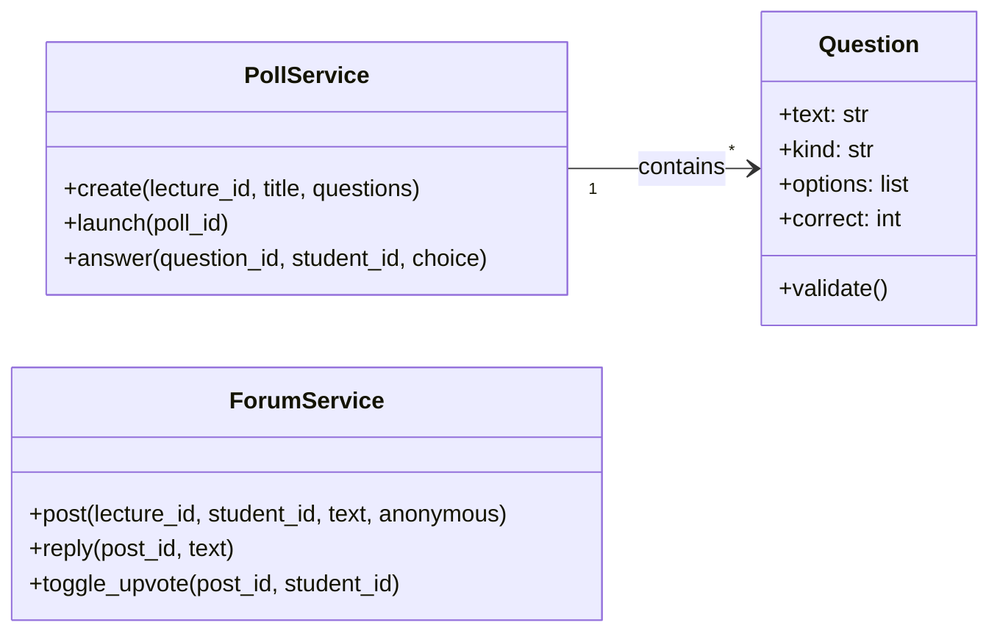
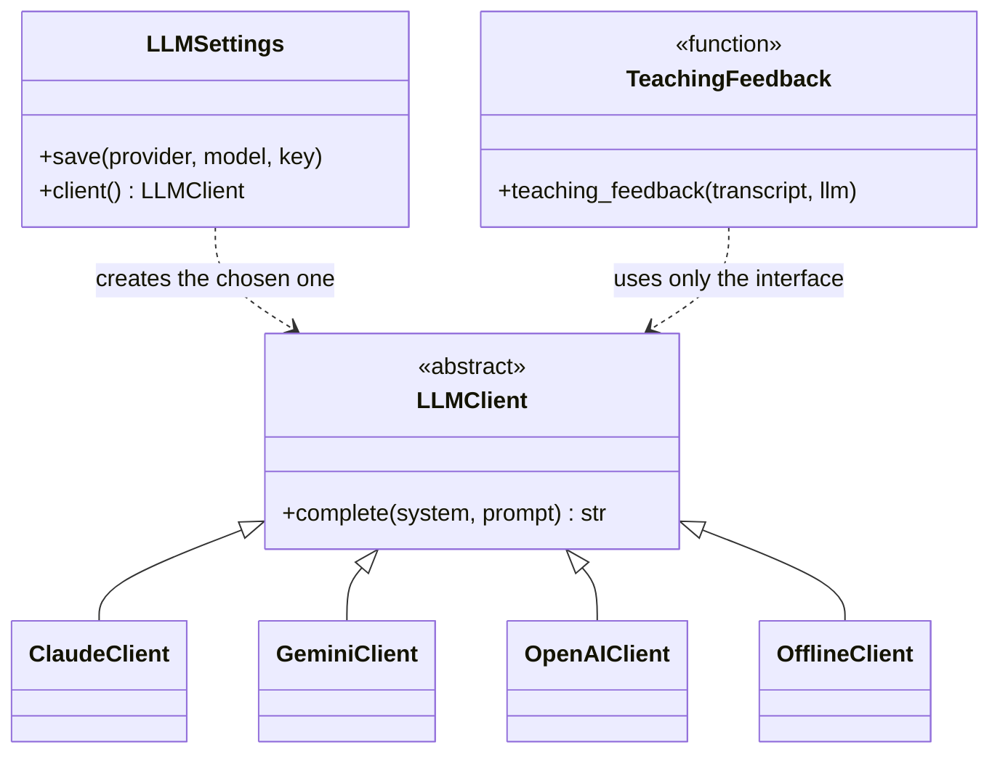
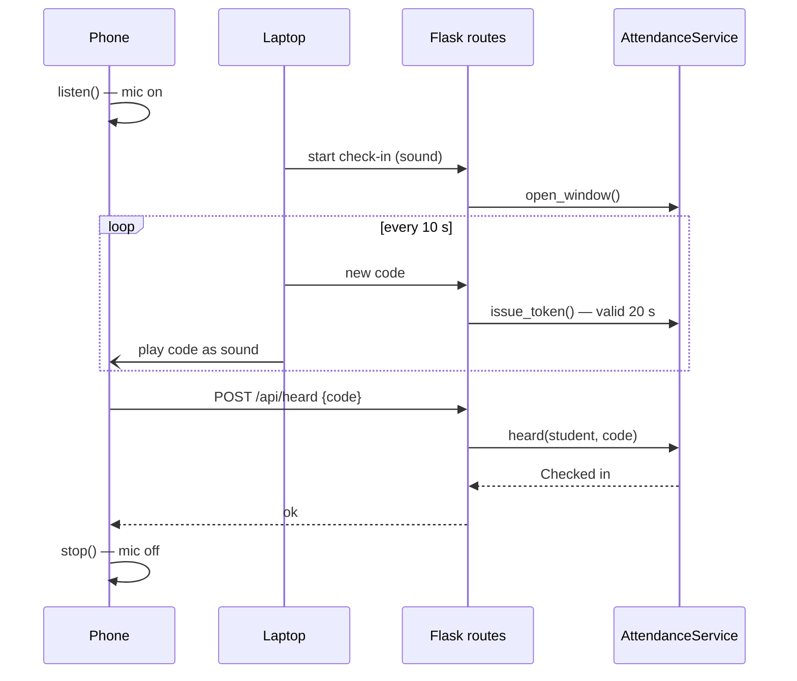
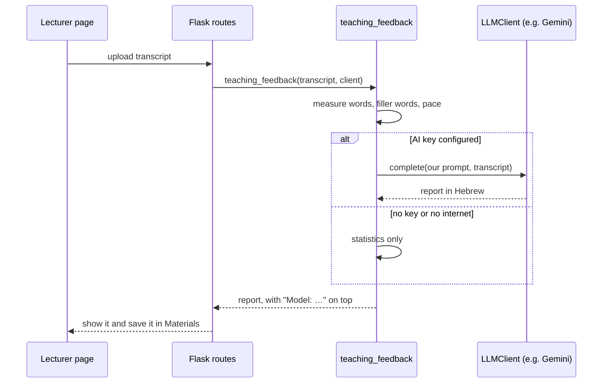

# Class and Sequence Diagrams

Assignment To-Do #8: *"Define low-level class diagrams and sequence diagrams."*

**How to read this document:**
- **Part A** shows the whole system on one page, in plain words, for any reader.
- **Part B** is the **low-level** design the assignment asks for: the real classes and methods in `app/`, split into small diagrams.

---

# Part A — The big picture (no technical background needed)

### A1. What the system is made of

A **course** has many **lectures**. Everything that happens in class (attendance, polls, questions, AI reports) belongs to a lecture.

### A2. How a student checks in (the main story)

A friend at home cannot hear the sound, and a recording is useless after 20 seconds. The other way in is a QR code on the projector, which works the same way.

---

# Part B — Low-level design (classes and methods)

All the classes below are in `app/`. Each service receives the database (`db`), and services that deal with time also receive a `clock`. That is what makes them testable ([Testing strategy](TESTING_STRATEGY.md)).

### B1. Courses, students and phones

**Design note:** `RosterSource` is an interface. Today the list comes from a CSV or Excel file; a Moodle source could be added later without changing `CourseRoster` (Open/Closed principle).

### B2. Lectures and attendance

**The lecture's states:**

Any other move, for example closing a draft, is refused (`LectureStateError`).

### B3. Polls and forum

`kind` is *quiz* (with a correct answer), *choice* or *text*. An anonymous post stores **no** student at all.

### B4. AI providers (Strategy pattern)

**Why this matters:** the teaching-feedback code talks only to `LLMClient`. Adding Gemini and OpenAI next to Claude did not change it at all. `OfflineClient` is used when there is no key, so nothing crashes.

---

### B5. Sequence: sound check-in (low level)

### B6. Sequence: teaching feedback (low level)

> **More detail:** every method is in the code (`app/*.py`), and each one is covered by a test listed in the [Testing strategy](TESTING_STRATEGY.md).
