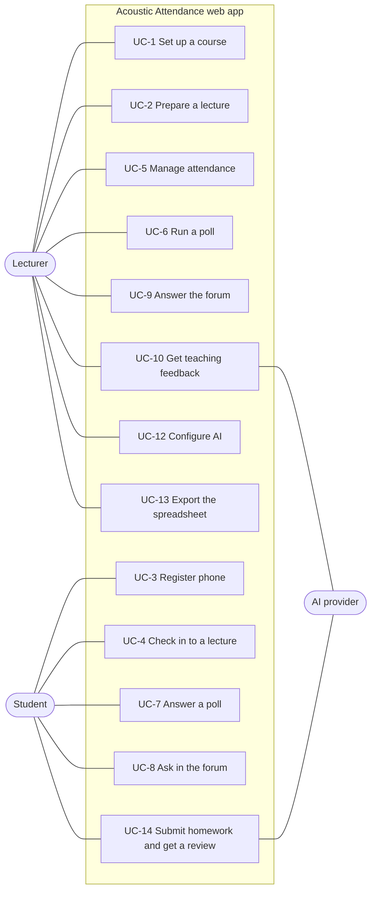

# Main Use Cases (client stories)

Assignment To-Do #6: *"Define the main use cases (client stories)."*
Each use case lists the actor, a user story, the main flow and its alternatives, and the SRS requirements it covers ([SRS](SRS.md)).

**Actors:** **Lecturer** (one, logged in with a PIN, on a laptop and projector) · **Student** (own smartphone, browser only) · **AI provider** (external: Claude, Gemini or OpenAI).

---

## UC-1 Set up a course
**Story:** *As a lecturer, I want to create a course and import my class list, so that only my students can check in.*
1. The lecturer creates a course ("+ Course").
2. The lecturer uploads the class list (CSV or xlsx): a `name` column, or first and last name. No ID numbers.
3. The system shows "Imported N students".

**Alternatives:** the file has no name column, or contains duplicate names → a clear error is shown and nothing is imported (E12).
**Covers:** FR-2.1–2.3

## UC-2 Prepare a lecture
**Story:** *As a lecturer, I want to prepare the lecture before class, so that I can run it with one click.*
1. The lecturer creates a lecture. It starts as a **Draft**, which students cannot see.
2. The lecturer adds polls and materials.
3. In class, the lecturer presses **Open lecture**. Students now see it.
4. At the end, the lecturer presses **Close lecture**. Everything stays editable.

**Alternatives:** closed by mistake → **Reopen** (E9).
**Covers:** FR-3.1–3.5

## UC-3 Register a phone
**Story:** *As a student, I want to identify myself once, so that I never type anything again.*
1. The student opens the app, for example by scanning the projector's *Join QR*.
2. The student starts typing their name and picks it from the list, then confirms.
3. The server links the name to this phone (HttpOnly cookie).

**Alternatives:**
- The name is already linked to another phone → refused. The lecturer resets it (E4).
- The student picked the wrong name → they pick the right one, and the wrong one is released (E5).

**Covers:** FR-4.1, FR-4.2, FR-4.9

## UC-4 Check in to a lecture ⭐ main use case
**Story:** *As a student, I want to check in with one tap, so that my attendance is recorded without wasting class time.*
1. The student opens the open lecture and taps **Get ready to check in**. The phone starts listening, for up to 2 minutes.
2. The lecturer presses **Start check-in (sound)**. The laptop plays a fresh code every ~10 s.
3. The phone decodes the code and sends it to the server.
4. The server checks the code: it must exist, be fresh, belong to an open window and be for a student of this course. It then marks the student **Present**.
5. The phone shows "✅ You're checked in" and **closes the microphone**.
6. The lecturer presses **End check-in**.

**Alternatives:**
- **4a QR path:** the lecturer chooses **Start check-in (QR)**, and the student scans the rotating QR with the phone camera (E1, E7).
- **4b Code expired or window ended:** the code is rejected, and the student asks the lecturer (E2, E3).
- **4c No sound heard within 2 minutes:** the mic closes and the student can try again (E1).

**Covers:** FR-4.3–4.7, FR-4.4a, NFR-1, NFR-4, NFR-7

## UC-5 Manage attendance
**Story:** *As a lecturer, I want to see who is here and fix exceptions, so that the record is correct.*
1. The lecturer watches the live sheet: a counter and a status for each student.
2. The lecturer changes a status by hand, for example **Late** for a latecomer, also after the lecture is closed.
3. The lecturer can **reset phone** for a student.

**Covers:** FR-4.8, FR-4.10, FR-4.12

## UC-6 Run a poll
**Story:** *As a lecturer, I want to check understanding with a quick poll, so that I know whether to repeat something.*
1. The lecturer builds a poll, or imports it from the xlsx/csv template. Question types: quiz (with a correct answer), multiple choice, free text.
2. The lecturer presses **Launch** during or after the lecture.
3. Results update live: bars, and % correct for quizzes.
4. The lecturer closes the poll, and may choose to show the correct answers.

**Covers:** FR-5.1–5.8

## UC-7 Answer a poll
**Story:** *As a student, I want to answer the lecturer's questions from my phone, even if I'm late or at home.*
1. The student sees the live poll and answers each question once.
2. If the lecturer allows it, the correct answer is shown after answering.

**Covers:** FR-5.2, FR-5.7, FR-4.12

## UC-8 Ask in the forum
**Story:** *As a student, I want to ask a question, anonymously if I prefer, so that I'm not embarrassed to ask.*
1. The student writes a question and chooses **named** or **anonymous**. Anonymous posts store no student reference.
2. Other students press 👍 "me too", and popular questions rise to the top.

**Covers:** FR-6.1, FR-6.2, FR-6.5

## UC-9 Answer the forum
**Story:** *As a lecturer, I want to answer questions during or after class, so that everyone sees the answer.*
1. The lecturer replies under a post, and students see the reply.
2. The lecturer deletes inappropriate posts (E11).

**Covers:** FR-6.3, FR-6.4

## UC-10 Get teaching feedback
**Story:** *As a lecturer, I want short, honest feedback on my lecture, so that I can teach better next week.*
1. The lecturer uploads or pastes the recording's transcript, for example from Zoom.
2. The system measures words, filler words and question marks. With a .vtt file it also measures pace and pauses.
3. The team's prompt, with the transcript, goes to the selected **AI provider**. The report comes back **in Hebrew**: student questions, examples and clarity, professional mistakes, 3 points to keep, 3 points to improve, and **the lecturer's commitments to students as tasks**.
4. The report is saved in the lecture's materials as *lecturer only*, and names the model that wrote it.

**Alternatives:** no key or no internet → only the measured statistics are shown (E10). A poor transcript → the model is instructed to say so rather than guess.
**Covers:** FR-7.5–7.7, FR-7.6a, FR-7.6b, FR-7.12

## UC-14 Submit homework and get a review (student)
**Story:** *As a student, I want feedback on my homework before the lecturer grades it, and to know how my work compares with the class, without seeing anyone else's work.*
1. The lecturer publishes an assignment in the course, with an optional deadline (📝 Assignments).
2. The student opens **📝 Homework** on the phone, reads the assignment and uploads their work (Word, PDF, text or code).
3. The AI receives the assignment, this work and up to 5 recent submissions of others, without names.
4. The student gets a review in Hebrew: meeting the requirements, strengths, what to improve, and **compared with the class** in general terms.
5. The lecturer sees all submissions with their dates, late flags and reviews.

**Alternatives:**
- Submitting again replaces the work and shows the new date (FR-7.20).
- After the deadline, the work is accepted and marked late.
- An unsupported file (e.g. a photo) gets a clear error.
- No AI key → the work is still submitted, with a note.
- Fewer than 2 other submissions → the review says the comparison is limited.

**Covers:** FR-7.16–7.21

## UC-12 Configure AI
**Story:** *As a lecturer, I want to use the AI provider I already have.*
1. In ⚙ Settings, the lecturer chooses a provider and a model (or a custom ID) and pastes an API key.
2. **Test connection** sends a tiny request.
3. The key stays on the server and is only ever shown masked.

**Covers:** FR-7.1–7.4, NFR-6

## UC-13 Export the spreadsheet
**Story:** *As a lecturer, I want attendance offline in Excel, so that I can archive it or upload it elsewhere.*
1. The lecturer presses **⬇ Excel** for the course.
2. The file contains an overview (students × lectures), one sheet per lecture, polls and the forum.

**Covers:** FR-4.11
